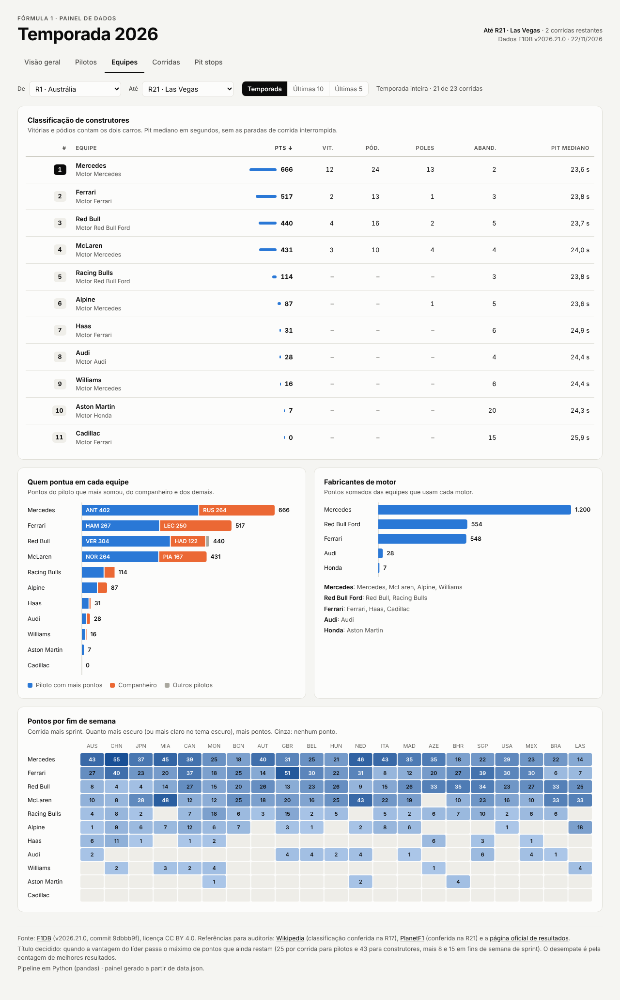
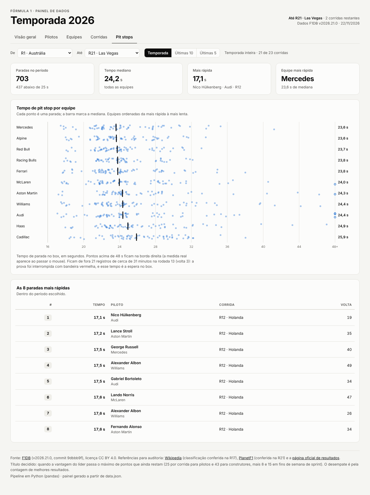
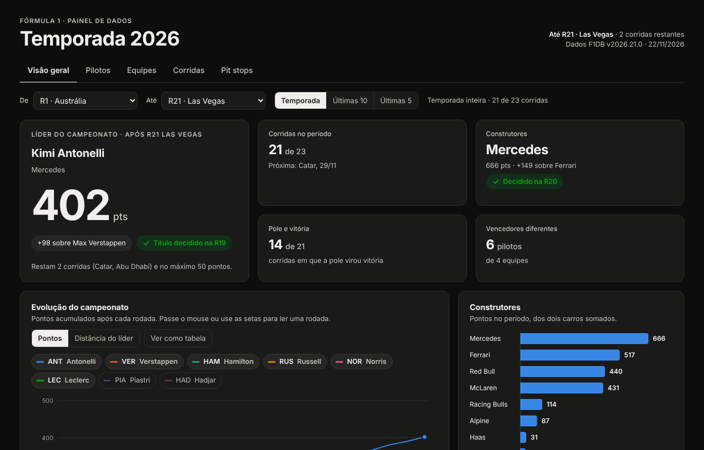

# Painel F1 2026 · Dados, pipeline e dashboard interativo

Painel interativo da temporada 2026 de Fórmula 1, feito com dados abertos. Em vez de uma tabela estática, o leitor escolhe o intervalo de corridas, abre a ficha de cada piloto e de cada Grande Prêmio e vê as classificações, os gráficos e os números se recalcularem na hora. Por trás dele há um pipeline em Python (pandas) que baixa, limpa, valida e exporta os dados.

> Projeto de estudo, sem vínculo com a Fórmula 1, a FIA ou o F1DB. Os dados são do [F1DB](https://github.com/f1db/f1db) (licença CC BY 4.0).

**Painel online:** https://victorchantre08.github.io/dashboard-formula1/

## Prévia

**Visão geral.** Líder do campeonato, evolução dos pontos, construtores, fabricantes de motor, vencedores e pódio das últimas corridas.


**Pilotos.** Tabela completa e, ao clicar em um piloto, a largada e a chegada dele em cada corrida.


**Equipes.** Classificação de construtores, quem pontua dentro de cada equipe, motores e um mapa de calor com os pontos de cada fim de semana.



**Corridas.** Calendário com vencedor, pole e volta mais rápida de cada prova.


**Detalhe de uma corrida.** Ao clicar em um GP concluído: pódio e classificação completa, com posição de largada, posições ganhas ou perdidas e pontos.


**Pit stops.** Cada ponto é uma parada; a barra preta é a mediana da equipe.



**Tema escuro.** O painel segue o tema do sistema.



**No celular.** O layout se adapta a telas estreitas.


## Sumário

- [Prévia](#prévia)
- [Para que serve](#para-que-serve)
- [Como abrir](#como-abrir)
- [Como navegar](#como-navegar)
- [O que cada aba faz](#o-que-cada-aba-faz)
- [Principais achados](#principais-achados)
- [Regras e fórmulas usadas](#regras-e-fórmulas-usadas)
- [Limitações e pontos de atenção](#limitações-e-pontos-de-atenção)
- [Detalhes técnicos](#detalhes-técnicos)
- [Próximos passos](#próximos-passos)
- [Autor](#autor)

## Para que serve

O painel responde, com os dados da temporada até a 21ª etapa (Las Vegas), perguntas como:

1. **Campeonato:** quem lidera, por quanto, e o título já está decidido?
2. **Pilotos:** quem ganha posições na corrida, quem abandona mais, quem converte pole em vitória?
3. **Equipes:** quem carrega os pontos de cada time e qual fabricante de motor está na frente?
4. **Corridas:** como foi cada Grande Prêmio, da largada à bandeirada?
5. **Pit stops:** qual equipe é mais rápida nas paradas e qual foi a parada mais rápida do ano?

Dá para testar cada resposta: ao mudar o intervalo de corridas, o líder, as médias e as tabelas mudam juntos. A pergunta "quem está melhor nas últimas 5 corridas?" tem uma resposta diferente da pergunta sobre a temporada inteira.

## Como abrir

**Online (mais simples):** acesse o endereço do painel, no topo desta página. Não precisa instalar nada.

**No computador:** o painel lê o arquivo `dashboard/data.json`, e por isso precisa ser aberto por um servidor local. Dar dois cliques no `index.html` não funciona. Com Python instalado, na pasta do projeto:

```bash
python -m http.server 8000 --directory dashboard
```

Depois abra `http://localhost:8000` no navegador.

**Publicar a sua própria cópia (GitHub Pages):** em **Settings → Pages**, escolha *Deploy from a branch*, branch `main` e pasta `/ (root)`. O GitHub gera um endereço no formato `https://<usuario>.github.io/<repositorio>/`. O `index.html` da raiz leva direto para `dashboard/`.

## Como navegar

- Cinco abas no topo: Visão geral, Pilotos, Equipes, Corridas e Pit stops. Cada uma tem endereço direto: `#pilotos`, `#equipes`, `#corridas` e `#pit-stops`.
- **Filtro de corridas:** os campos *De* e *Até*, ou os atalhos *Temporada*, *Últimas 10* e *Últimas 5*. Vale para todas as abas, exceto Corridas.
- No gráfico de evolução, os botões com a sigla de cada piloto ligam e desligam as linhas. *Pontos* e *Distância do líder* trocam a medida, e *Ver como tabela* mostra os mesmos números em tabela.
- Passe o mouse sobre barras, pontos e células para ver os valores exatos. No gráfico de evolução, as setas **←** e **→** do teclado percorrem as rodadas.
- Clique no cabeçalho de uma coluna para ordenar, no piloto para ver a ficha dele e na corrida para abrir o detalhe.
- O painel segue o tema claro ou escuro do sistema e se adapta ao celular.

## O que cada aba faz

### 1 · Visão geral

- **Líder do campeonato:** pontos, vantagem sobre o segundo e o aviso *Título decidido na R__* quando a vantagem passa o máximo de pontos que ainda restam.
- **Cartões:** corridas no período e a próxima prova, quantas poles viraram vitória e quantos pilotos e equipes diferentes venceram.
- **Evolução do campeonato:** pontos acumulados após cada rodada, com seleção de pilotos e visão em tabela.
- **Construtores e fabricantes de motor:** pontos no período, com as equipes que usam cada motor.
- **Quem venceu** e **Últimas corridas:** vitórias por piloto e pódio das seis corridas mais recentes (o *S* marca fim de semana de sprint).

### 2 · Pilotos

- **Tabela de classificação:** pontos, vitórias, pódios, poles, voltas mais rápidas, abandonos, posição média de largada e de chegada e saldo de posições por corrida.
- **Largada e chegada:** ao clicar em um piloto, um gráfico liga a posição de largada à de chegada em cada prova. Um traço longo indica uma corrida de recuperação (ou de queda).

### 3 · Equipes

- **Classificação de construtores:** pontos, vitórias, pódios, poles, abandonos e mediana de pit stop.
- **Quem pontua em cada equipe:** a divisão dos pontos entre o piloto que mais somou, o companheiro e os demais.
- **Fabricantes de motor:** soma das equipes que usam cada unidade de potência.
- **Pontos por fim de semana:** mapa de calor equipe × corrida; quanto mais escuro, mais pontos.

### 4 · Corridas

- Calendário completo com data, circuito, vencedor, pole, volta mais rápida e situação (concluída, próxima ou agendada).
- Ao clicar em uma corrida concluída, o detalhe mostra o pódio e a classificação completa, com posição de largada, posições ganhas ou perdidas, tempo ou diferença para o vencedor e pontos. Quem não terminou aparece com o motivo (colisão, freios etc.).

### 5 · Pit stops

- **Cartões:** total de paradas, tempo mediano, parada mais rápida e equipe mais rápida.
- **Tempo por equipe:** cada ponto é uma parada e a barra preta marca a mediana.
- **As 8 paradas mais rápidas** do período escolhido.

## Principais achados

Números até a 21ª etapa (Las Vegas), com a temporada inteira selecionada. Cada um foi conferido nas tabelas do projeto.

1. **O título de pilotos já está decidido.** Kimi Antonelli lidera com 402 pontos, 98 à frente de Max Verstappen, e venceu 9 das 21 corridas. Depois da R19, a vantagem era de 119 pontos e só restavam 100 em disputa (4 corridas de 25 pontos). Na R18 ainda não estava: 123 de vantagem contra 125 possíveis.
2. **A Mercedes dominou a temporada.** São 666 pontos, 12 das 21 vitórias e apenas 2 abandonos em 42 participações de carro. O título de construtores ficou decidido na R20.
3. **Verstappen chega ao fim do ano em alta.** Venceu 4 das últimas 6 corridas (R16, R17, R19 e R21) e foi quem mais pontuou nas últimas 5 rodadas: 116 pontos contra 82 de Antonelli.
4. **A Red Bull depende de um piloto.** Verstappen fez 304 dos 440 pontos da equipe (69%). Isack Hadjar, o companheiro, tem 122.
5. **O 4º lugar foi decidido no desempate.** George Russell e Lando Norris têm 264 pontos e 3 vitórias cada. Russell fica à frente por ter mais segundos lugares (4 contra 2).
6. **A pole vale muito.** 14 das 21 poles viraram vitória (67%).
7. **O fim do grid sofreu com a confiabilidade.** A Aston Martin fez 7 pontos e abandonou 20 vezes em 42 participações (Stroll 13, Alonso 7). A Cadillac não pontuou e abandonou 15 vezes.
8. **Os pit stops são parecidos entre as equipes.** A mediana geral é de 24,2 s. Mercedes e Alpine (23,6 s) são as mais rápidas e a Cadillac (25,9 s) a mais lenta: 2,3 s separam os extremos. A parada mais rápida do ano foi de Nico Hülkenberg, 17,1 s, na Holanda (R12).

## Regras e fórmulas usadas

- **Pontos:** corrida + sprint. Pilotos e equipes são somados pelos pontos reais da fonte.
- **Título decidido:** a vantagem do líder sobre o segundo passa o máximo de pontos que ainda podem ser conquistados. Pilotos: 25 por corrida restante, mais 8 por sprint restante. Equipes: 43 por corrida (25 + 18) e 15 por sprint (8 + 7). Não há ponto extra pela volta mais rápida.
- **Desempate:** contagem de melhores resultados (mais vitórias, depois mais segundos lugares e assim por diante), como no regulamento.
- **Saldo de posições:** posição de largada menos posição de chegada. A média de chegada ignora quem não terminou.
- **Pit stops:** as paradas de 600 s ou mais são tratadas como corrida interrompida e ficam fora dos cálculos (veja as limitações).
- **Intervalo de corridas:** todas as classificações, médias e gráficos são recalculados para as corridas escolhidas.

## Limitações e pontos de atenção

- **Faltam duas corridas.** Os dados vão até a R21 (F1DB v2026.21.0, de 22/11/2026). Catar (29/11) e Abu Dhabi (06/12) entram quando o F1DB publicar a nova versão e o pipeline rodar de novo.
- **A R16 foi disputada em Sepang, na Malásia.** O "Bahrain Grand Prix" aparece assim na fonte porque Bahrein e Arábia Saudita saíram do calendário e a prova foi realizada na Malásia sob o nome oficial *Gulf Air Bahrain Grand Prix in Malaysia*. O painel mostra "Bahrein (Sepang)".
- **R13 (Itália) teve bandeira vermelha na volta 3** (acidente de Leclerc). A fonte registra 21 paradas de cerca de 31 minutos, que são a espera no box. O painel as exclui do cálculo de pit stops e avisa na aba. A tabela `Pit_Stops` mantém os registros originais.
- **Tempos de pit stop.** Os valores da fonte (de 17 a 48 s, mediana de 24 s) são compatíveis com o tempo total de passagem pelo pit lane, e não com os 2 a 3 segundos em que o carro fica parado.
- **Datas em UTC.** A largada de Las Vegas foi no sábado à noite no horário local; em UTC, domingo (22/11).
- **Amostras pequenas.** Pilotos que correram poucas vezes (por exemplo, Ryō Hirakawa) têm médias que variam muito. Interprete com cuidado.
- **Nomes em inglês**, como na fonte (pilotos, equipes e circuitos).
- **Conferências externas:** a classificação foi conferida com fontes independentes nas rodadas R17 (Wikipedia) e R21 (PlanetF1). As rodadas intermediárias (R18 a R20) fecham pela soma interna dos pontos e pelos vencedores da R1 à R18, mas não têm uma segunda fonte para a classificação completa.

## Detalhes técnicos

### Fonte dos dados

| Fonte | Uso | Licença |
|---|---|---|
| [F1DB](https://github.com/f1db/f1db) | Calendário, pilotos, equipes, resultados, qualificação, pit stops e classificações | CC BY 4.0 |

O pipeline registra em `data/processed/manifest.json` qual versão da fonte foi usada (release, commit e data), para que qualquer número possa ser rastreado até a origem.

> Atribuição: *Dados: F1DB (github.com/f1db/f1db), licença CC BY 4.0.*

Referências para auditoria: [formula1.com/results](https://www.formula1.com/en/results) e as [classificações da FIA](https://api.fia.com/events/fia-formula-one-world-championship/season-2026/2026-classifications).

### Como o pipeline funciona

```
extract.py   ->  transform.py  ->  validate.py  ->  load.py        ->  export.py
git clone/        pandas: merges,    checagens de      CSVs + Excel      dashboard/data.json
pull do F1DB      explode, groupby   consistência      + manifest.json   (consumido pelo painel)
```

| Etapa | O que faz |
|---|---|
| **Extract** | Clona (ou atualiza) o F1DB em `data/raw/f1db` e registra a versão usada |
| **Transform** | Lê os YAML, empilha as corridas, cruza com os cadastros (pilotos, equipes, circuitos, países), converte tempos em segundos, separa posição numérica de situação (DNF, DNS, NC...) e calcula métricas por piloto e equipe |
| **Validate** | Confere que os pontos de corridas + sprints fecham com as classificações oficiais, que não há duplicatas, que todo ID tem nome, etc. O pipeline termina com erro se algo não fechar |
| **Load** | Grava um CSV por tabela, um Excel formatado (tabelas, filtros, aba de validação) e o manifesto da fonte |
| **Export** | Gera `dashboard/data.json`, um JSON compacto (uma linha por piloto por corrida) que o painel lê |

### Como executar

```bash
python -m venv .venv && source .venv/bin/activate   # Windows: .venv\Scripts\activate
pip install -r requirements.txt

python run_pipeline.py                # baixa/atualiza o F1DB e gera tudo
python run_pipeline.py --skip-extract # reaproveita o F1DB já baixado
python run_pipeline.py --year 2025    # outra temporada

pytest                                # testes
```

Requisitos: Python 3.10+ e `git` instalado (testado com Python 3.13 e pandas 3.0).

### Saídas

- `data/processed/*.csv`: uma tabela por arquivo (UTF-8, datas em `AAAA-MM-DD`)
- `output/F1_2026_base_de_dados.xlsx`: as mesmas tabelas, mais as abas `LEIA-ME` e `Validação`
- `data/processed/manifest.json`: versão da fonte e contagem de linhas por tabela
- `dashboard/data.json`: dados do painel

### Modelo de dados

| Tipo | Tabelas |
|---|---|
| Dimensões | `Calendário`, `Pilotos`, `Equipes`, `Equipe_Pilotos` |
| Fatos | `Resultados_Corrida`, `Resultados_Sprint`, `Qualificação`, `Grid_Largada`, `Pit_Stops`, `Voltas_Rápidas`, `Piloto_do_Dia` |
| Classificações | `Classif_Pilotos`, `Classif_Construtores`, `Classif_Pilotos_Rodada`, `Classif_Construtores_Rodada` (`Classif_` é abreviação de classificação) |

As tabelas se relacionam por `Rodada`, `Piloto_ID` e `Equipe_ID` (esquema estrela: fatos ligados às dimensões por esses IDs). Notas de modelagem:

- `Posição` vazia significa não classificado; o motivo está em `Situação` (`DNF`, `DNS`, `NC`...).
- Horários em UTC.
- `Pilotos` e `Equipes` trazem `Pontos_Oficiais` (da classificação), `Pontos_Calculados` (corridas + sprints) e `Diferença`, para auditar a consistência da própria base.
- Pilotos reservas aparecem em `Pilotos` com `Papel = Piloto de testes/reserva` e, quando atendem a duas equipes, ambas ficam listadas.

### Validação e qualidade

O pipeline roda 10 verificações a cada execução (aba `Validação` e saída no terminal). Na execução de referência (F1DB v2026.21.0, rodadas 1 a 21), todas passaram: 2.337 pontos fecham entre pilotos e construtores, sem diferença em nenhum piloto ou equipe, e há 21 vitórias para 21 corridas.

Conferências externas feitas durante o desenvolvimento:

| Conferência | Resultado |
|---|---|
| Classificação após a R17 contra a [Wikipedia](https://en.wikipedia.org/wiki/2026_Formula_One_World_Championship) (23 pilotos e 11 equipes) | Nenhuma diferença |
| Vencedores das rodadas 1 a 18 contra a Wikipedia | Nenhuma diferença |
| Classificação final após a R21 (25 pilotos e 11 equipes) contra a [PlanetF1](https://www.planetf1.com/news/f1-championship-standings-2026-las-vegas-grand-prix) | Nenhuma diferença |
| Calendário (23 rodadas, GPs, cidades e fins de semana de prova) contra a [Crash.net](https://www.crash.net/f1/news/1073119/1/2026-f1-calendar-full-race-schedule-revealed) | Confere, incluindo Sepang |
| Tabelas do pipeline contra uma implementação independente anterior (script manual com openpyxl) | 49.881 células comparadas, nenhuma divergência |

Testes automatizados (`pytest`, 18 testes): leitura de YAML, transformação e validação de uma mini-temporada sintética ponta a ponta (inclui o caso de a validação falhar quando os pontos não fecham), exportação para o painel (formato das linhas, exclusão de paradas de bandeira vermelha, rejeição de sprint sem corrida) e grafia dos arquivos gerados (nomes e cabeçalhos com acento, singular e plural no texto da aba `LEIA-ME`).

### Decisões técnicas

- **pandas, e não PySpark.** A base inteira tem alguns milhares de linhas; mesmo a história completa da F1 cabe em memória. Spark adicionaria complexidade e custo de inicialização sem ganho. O pipeline é organizado em extract/transform/validate/load justamente para que a troca de ferramenta seja localizada se o volume crescer.
- **Leitura de YAML sem a regra sexagesimal do YAML 1.1.** O PyYAML padrão transforma `14:00` em `840`; o loader em `yamlio.py` evita isso (há teste cobrindo o caso).
- **Rastreabilidade.** Dado bruto fica separado do processado, e o commit da fonte é registrado a cada execução.
- **Nomes sem acento no código, com acento nos arquivos.** Dentro do código as tabelas e colunas não levam acento (`Calendario`, `Posicao`), o que facilita digitar e buscar. Na hora de gravar, `names.py` troca pelos nomes corretos (`Calendário`, `Posição`) em CSV, Excel e relatório de validação. Os nomes dos arquivos CSV também levam acento.
- **Validação como parte do pipeline**, e não como passo manual: se os pontos não fecham, a execução falha.
- **Painel sem framework e sem build.** HTML, CSS e JavaScript puros com SVG inline: abre em qualquer servidor estático e não usa bibliotecas externas. A única chamada externa é a fonte Inter, do Google Fonts; sem ela, o painel usa a fonte do sistema. Os cálculos por intervalo de rodadas ficam no navegador, então o JSON leva só fatos, sem agregados pré-calculados.
- **Cores categóricas fixas por piloto** (os 8 primeiros), com tema claro e escuro validados para daltonismo, e visão em tabela dos gráficos para quem não depende de cor.

### Atualização automática

`.github/workflows/update-data.yml` roda às segundas e terças (09:00 UTC), executa os testes e o pipeline e grava no repositório os arquivos que mudaram. Também pode ser disparado manualmente na aba *Actions*.

### Estrutura do repositório

```
dashboard-formula1/
├── index.html               # redireciona para dashboard/ (GitHub Pages)
├── dashboard/               # index.html + data.json (painel)
├── run_pipeline.py          # ponto de entrada (CLI)
├── requirements.txt
├── src/f1pipeline/
│   ├── config.py            # caminhos e constantes
│   ├── yamlio.py            # leitura de YAML
│   ├── extract.py           # sincroniza o F1DB
│   ├── transform.py         # YAML -> tabelas (pandas)
│   ├── validate.py          # checagens de qualidade
│   ├── load.py              # CSV + Excel + manifesto
│   ├── names.py             # nomes com acento para arquivos e planilhas
│   └── export.py            # tabelas -> dashboard/data.json
├── tests/                   # pytest (helpers, mini-temporada, exportação, nomes)
├── docs/img/                # imagens do README
├── .github/workflows/       # atualização automática dos dados
├── data/
│   ├── raw/                 # clone do F1DB (ignorado pelo git)
│   └── processed/           # CSVs gerados
└── output/                  # Excel gerado
```

## Próximos passos

- Atualizar com Catar (29/11) e Abu Dhabi (06/12) e fechar a temporada.
- Versão do dashboard no Power BI sobre as tabelas de `data/processed/`.
- Complementar com outras fontes (por exemplo, telemetria) caso o escopo cresça.

## Autor

Victor · [github.com/VictorChantre08](https://github.com/VictorChantre08)
