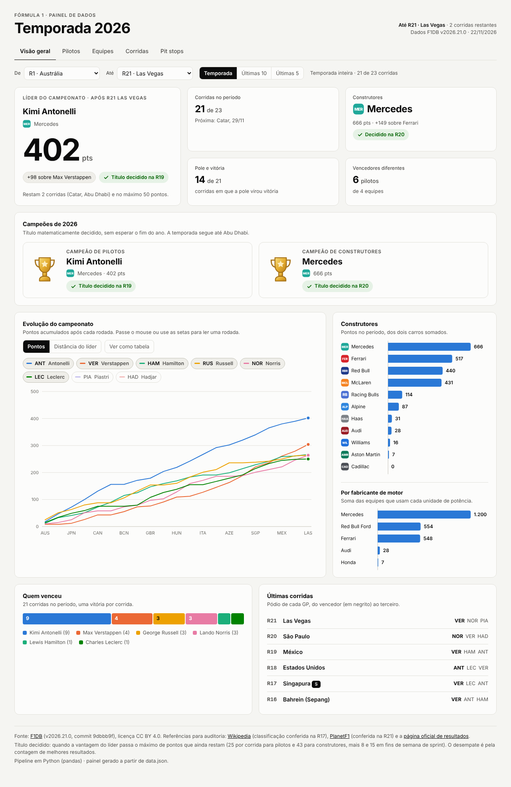
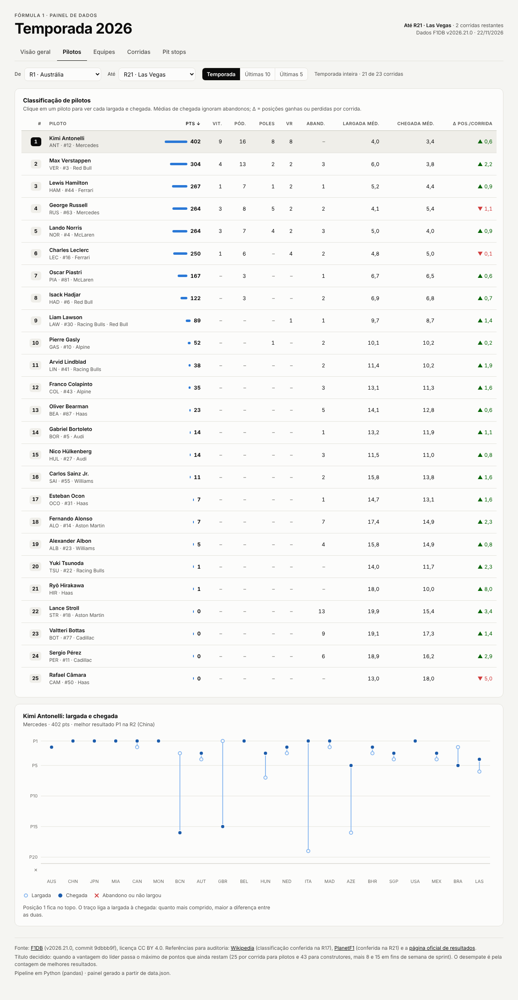
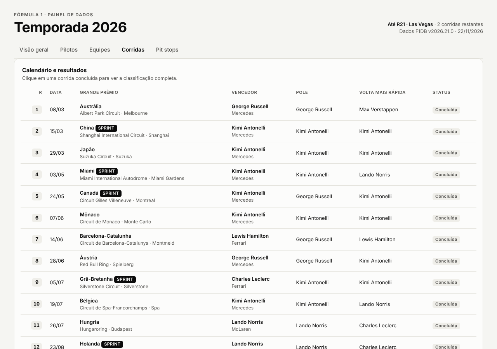
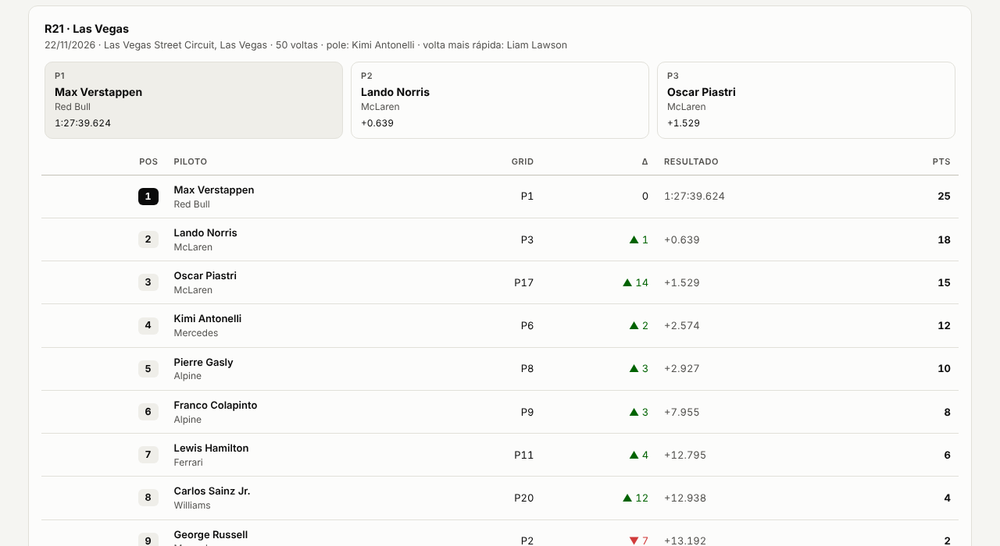
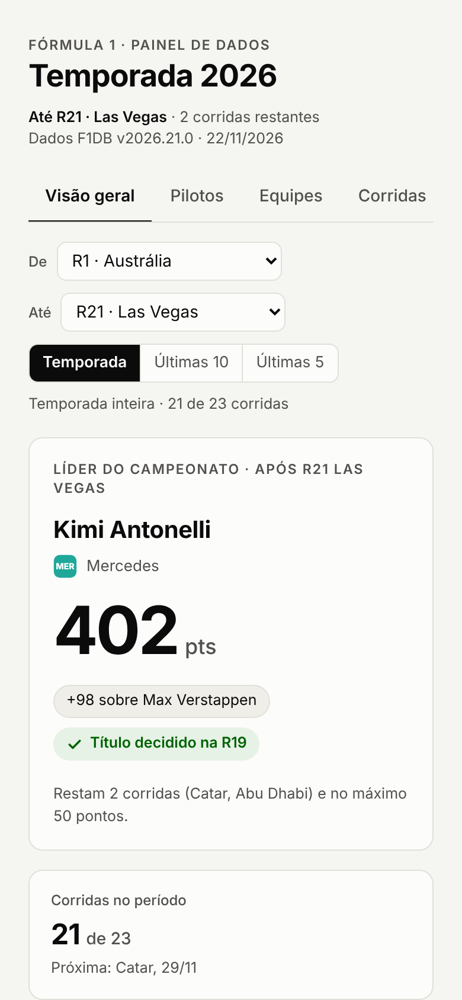

# Painel F1 2026 · Dados, pipeline e dashboard interativo

Montei um painel interativo da temporada 2026 de Fórmula 1 a partir de dados abertos. Em vez de uma tabela estática, quem visita escolhe o intervalo de corridas, abre a ficha de cada piloto e de cada Grande Prêmio e vê classificações, gráficos e médias se recalcularem na hora. Por trás do painel há um pipeline em Python (pandas) que baixa, limpa, valida e exporta os dados.

> Projeto de estudo, sem vínculo com a Fórmula 1, a FIA ou o F1DB. Os dados são do [F1DB](https://github.com/f1db/f1db) (licença CC BY 4.0).

**Painel online:** https://victorchantre08.github.io/dashboard-formula1/

## Prévia

**Visão geral.** Líder do campeonato, taças dos campeões de pilotos e de construtores, evolução dos pontos, construtores com o emblema de cada equipe, fabricantes de motor, vencedores e pódio das últimas corridas.



**Pilotos.** Tabela completa e, ao clicar em um piloto, a largada e a chegada dele em cada corrida.



**Equipes.** Classificação de construtores com o emblema de cada equipe, quem pontua dentro de cada equipe, motores e um mapa de calor com os pontos de cada fim de semana.


**Corridas.** Calendário com vencedor, pole e volta mais rápida de cada prova.



**Detalhe de uma corrida.** Ao clicar em um GP concluído: pódio e classificação completa, com posição de largada, posições ganhas ou perdidas e pontos.



**Pit stops.** Cada ponto é uma parada; a barra preta é a mediana da equipe.


**Tema escuro.** O painel segue o tema do sistema.


**No celular.** O layout se adapta a telas estreitas.



## Sumário

- [Prévia](#prévia)
- [Como conduzi o projeto](#como-conduzi-o-projeto)
- [Para que serve](#para-que-serve)
- [Como abrir](#como-abrir)
- [Como navegar](#como-navegar)
- [O que cada aba faz](#o-que-cada-aba-faz)
- [Principais achados](#principais-achados)
- [Como funciona por dentro](#como-funciona-por-dentro)
- [Regras e fórmulas usadas](#regras-e-fórmulas-usadas)
- [Como conferi os números](#como-conferi-os-números)
- [Limitações e pontos de atenção](#limitações-e-pontos-de-atenção)
- [Detalhes técnicos](#detalhes-técnicos)
- [Próximos passos](#próximos-passos)
- [Autor](#autor)

## Como conduzi o projeto

Quis um projeto de análise de dados que eu pudesse mostrar no GitHub e no LinkedIn e que fosse além de uma planilha: uma base confiável, um código que qualquer pessoa consiga rodar de novo e um painel que o visitante possa operar. Contei com o Claude, um assistente de IA, para escrever o código. O escopo, as decisões e a exigência de conferir cada número foram meus.

Estas foram as decisões que tomei ao longo do caminho:

| Decisão | O que escolhi | Por quê |
|---|---|---|
| Ponto de partida | Uma base em Excel com todos os dados relevantes e com as fontes citadas | Para poder defender a origem de cada número |
| Ferramenta | pandas, e não PySpark | A base tem poucos milhares de linhas. Spark traria complexidade sem ganho |
| Produto final | Um painel moderno e interativo, aberto ao público | Quem visita deve poder operar, como no meu painel do case iFood |
| Qualidade | Só entregar depois de conferir tudo | Um painel com número errado perde a credibilidade inteira |
| Língua | Português correto em tudo, inclusive nos nomes de abas e colunas | É um projeto para o mercado brasileiro |

O repositório mostra o resultado dessas escolhas. As seções abaixo explicam primeiro o que o painel faz, em linguagem simples, e depois como ele foi construído.

## Para que serve

O painel responde, com os dados da temporada até a 21ª etapa (Las Vegas), a perguntas como:

1. **Campeonato:** quem lidera, por quanto, e o título já está decidido?
2. **Pilotos:** quem ganha posições na corrida, quem abandona mais, quem converte a pole em vitória?
3. **Equipes:** quem carrega os pontos de cada time e qual fabricante de motor está na frente?
4. **Corridas:** como foi cada Grande Prêmio, da largada à bandeirada?
5. **Pit stops:** qual equipe é mais rápida nas paradas e qual foi a parada mais rápida do ano?

Dá para testar cada resposta. Ao mudar o intervalo de corridas, o líder, as médias e as tabelas mudam juntos. A pergunta "quem está melhor nas últimas 5 corridas?" tem uma resposta diferente da pergunta sobre a temporada inteira.

## Como abrir

**Online (mais simples):** acesse o endereço do painel, no topo desta página. Não precisa instalar nada.

**No computador:** o painel lê o arquivo `dashboard/data.json` e por isso precisa ser aberto por um servidor local. Dar dois cliques no `index.html` não funciona. Com Python instalado, na pasta do projeto:

```bash
python -m http.server 8000 --directory dashboard
```

Depois abra `http://localhost:8000` no navegador.

**Publicar a sua própria cópia (GitHub Pages):** em **Settings → Pages**, escolha *Deploy from a branch*, a branch `main` e a pasta `/ (root)`. O GitHub gera um endereço no formato `https://<usuario>.github.io/<repositorio>/`. O `index.html` da raiz leva direto para `dashboard/`.

## Como navegar

- Cinco abas no topo: Visão geral, Pilotos, Equipes, Corridas e Pit stops. Cada uma tem endereço direto: `#pilotos`, `#equipes`, `#corridas` e `#pit-stops`.
- **Filtro de corridas:** os campos *De* e *Até*, ou os atalhos *Temporada*, *Últimas 10* e *Últimas 5*. Vale para todas as abas, exceto Corridas.
- No gráfico de evolução, os botões com a sigla de cada piloto ligam e desligam as linhas. *Pontos* e *Distância do líder* trocam a medida, e *Ver como tabela* mostra os mesmos números em tabela.
- Passe o mouse sobre barras, pontos e células para ver os valores exatos. No gráfico de evolução, as setas **←** e **→** do teclado percorrem as etapas.
- Clique no cabeçalho de uma coluna para ordenar, no piloto para abrir a ficha dele e na corrida para ver o detalhe.
- O painel segue o tema claro ou escuro do sistema e se adapta ao celular.

## O que cada aba faz

### 1 · Visão geral

- **Líder do campeonato:** pontos, vantagem sobre o segundo colocado e o aviso *Título decidido na R__*, que aparece quando a vantagem passa o máximo de pontos ainda em disputa.
- **Campeões:** duas taças, uma para o campeão de pilotos e outra para o de construtores. A taça dourada aparece quando o título já está matematicamente decidido, com a etapa em que isso aconteceu. Enquanto o título está em aberto, a taça fica apagada e mostra o líder. Essa seção usa sempre a temporada inteira e não muda com o filtro de corridas.
- **Cartões:** corridas no período, a próxima prova, quantas poles viraram vitória e quantos pilotos e equipes diferentes venceram.
- **Evolução do campeonato:** pontos acumulados após cada etapa, com seleção de pilotos e visão em tabela.
- **Construtores e fabricantes de motor:** pontos no período, com as equipes que usam cada motor. Cada equipe tem um emblema com a sigla e a cor dela.
- **Quem venceu** e **Últimas corridas:** vitórias por piloto e pódio das seis corridas mais recentes (o *S* marca fim de semana de sprint).

### 2 · Pilotos

- **Tabela de classificação:** pontos, vitórias, pódios, poles, voltas mais rápidas, abandonos, posição média de largada e de chegada e saldo de posições por corrida.
- **Largada e chegada:** ao clicar em um piloto, um gráfico liga a posição de largada à de chegada em cada prova. Um traço longo indica uma corrida de recuperação (ou de queda).

### 3 · Equipes

- **Classificação de construtores:** pontos, vitórias, pódios, poles, abandonos e mediana de pit stop.
- **Quem pontua em cada equipe:** a divisão dos pontos entre o piloto que mais somou, o companheiro e os demais.
- **Fabricantes de motor:** soma das equipes que usam cada unidade de potência.
- **Pontos por fim de semana:** mapa de calor de equipe por corrida. Quanto mais escuro, mais pontos.

### 4 · Corridas

- Calendário completo com data, circuito, vencedor, pole, volta mais rápida e situação (concluída, próxima ou agendada).
- Ao clicar em uma corrida concluída, o detalhe mostra o pódio e a classificação completa, com posição de largada, posições ganhas ou perdidas, tempo ou diferença para o vencedor e pontos. Quem não terminou aparece com o motivo (colisão, freios etc.).

### 5 · Pit stops

- **Cartões:** total de paradas, tempo mediano, parada mais rápida e equipe mais rápida.
- **Tempo por equipe:** cada ponto é uma parada e a barra preta marca a mediana.
- **As 8 paradas mais rápidas** do período escolhido.

## Principais achados

Números até a 21ª etapa (Las Vegas), com a temporada inteira selecionada. Conferi cada um nas tabelas do projeto.

1. **O título de pilotos já está decidido.** Kimi Antonelli lidera com 402 pontos, 98 à frente de Max Verstappen, e venceu 9 das 21 corridas. Depois da R19, a vantagem era de 119 pontos e restavam só 100 em disputa (4 corridas de 25 pontos). Na R18 ainda não estava decidido: 123 de vantagem contra 125 possíveis.
2. **A Mercedes dominou a temporada.** Somou 666 pontos, venceu 12 das 21 corridas e teve apenas 2 abandonos em 42 largadas de carro. O título de construtores foi decidido na R20.
3. **Verstappen chega ao fim do ano em alta.** Venceu 4 das últimas 6 corridas (R16, R17, R19 e R21) e foi quem mais pontuou nas últimas 5 etapas: 116 pontos contra 82 de Antonelli.
4. **A Red Bull depende de um piloto.** Verstappen fez 304 dos 440 pontos da equipe (69%). Isack Hadjar, o companheiro, tem 122.
5. **O 4º lugar foi decidido no desempate.** George Russell e Lando Norris têm 264 pontos e 3 vitórias cada. Russell fica à frente por ter mais segundos lugares (4 contra 2).
6. **A pole vale muito.** 14 das 21 poles viraram vitória (67%).
7. **O fim do grid sofreu com a confiabilidade.** A Aston Martin somou 7 pontos e abandonou 20 vezes em 42 largadas (Stroll 13, Alonso 7). A Cadillac não pontuou e abandonou 15 vezes.
8. **Os pit stops são parecidos entre as equipes.** A mediana geral é de 24,2 s. Mercedes e Alpine (23,6 s) são as mais rápidas e a Cadillac (25,9 s) é a mais lenta: 2,3 s separam os extremos. A parada mais rápida do ano foi de Nico Hülkenberg, com 17,1 s, na Holanda (R12).

## Como funciona por dentro

### Em uma frase

Os dados saem de um repositório público, passam por uma esteira de cinco etapas que limpa e confere tudo, e viram um arquivo `data.json` que o painel lê e transforma em gráficos.

### A esteira, etapa por etapa

```
extract.py   ->  transform.py  ->  validate.py  ->  load.py        ->  export.py
git clone/        pandas: merges,    checagens de      CSVs + Excel      dashboard/data.json
pull do F1DB      explode, groupby   consistência      + manifest.json   (lido pelo painel)
```

| Etapa | Em linguagem simples | O que o código faz |
|---|---|---|
| **Extract** | Busca os dados mais recentes | Clona (ou atualiza) o F1DB em `data/raw/f1db` e registra a versão usada |
| **Transform** | Arruma e junta tudo | Lê os arquivos YAML, empilha as corridas, cruza com os cadastros (pilotos, equipes, circuitos, países), converte tempos em segundos, separa a posição numérica da situação (DNF, DNS, NC...) e calcula as métricas por piloto e equipe |
| **Validate** | Confere se os números fecham | Verifica se os pontos de corridas e sprints batem com as classificações oficiais, se não há duplicatas e se todo ID tem nome. Se algo não fechar, o pipeline termina com erro |
| **Load** | Guarda o resultado | Grava um CSV por tabela, um Excel formatado (tabelas, filtros e aba de validação) e o manifesto da fonte |
| **Export** | Prepara os dados do painel | Gera `dashboard/data.json`, um JSON compacto com uma linha por piloto por corrida |

### O caminho de um número

Para ficar concreto, veja como se chega aos **402 pontos de Antonelli**:

1. O F1DB guarda o resultado de cada corrida e de cada sprint em arquivos YAML.
2. O `transform.py` lê todos os arquivos e monta a tabela `Resultados_Corrida` (e a de sprint), com uma linha por piloto por corrida.
3. A soma dos pontos de Antonelli nessas tabelas vira a coluna `Pontos_Calculados`.
4. O `validate.py` compara esse total com `Pontos_Oficiais`, que vem da classificação publicada na fonte. A diferença tem de ser zero.
5. O `export.py` grava as linhas de cada corrida no `data.json`.
6. O painel soma de novo, no navegador, só as corridas do intervalo escolhido. Com a temporada inteira, o total é o mesmo: 402.

### Por que o painel recalcula tudo no navegador

O `data.json` guarda só fatos (quem largou em que posição, quem chegou em qual, quantos pontos fez), sem totais prontos. Assim, qualquer intervalo de corridas gera uma classificação nova na hora, sem servidor. O custo é que o navegador faz as contas, mas com 21 corridas isso é instantâneo.

## Regras e fórmulas usadas

- **Pontos:** corrida mais sprint. Pilotos e equipes são somados pelos pontos reais da fonte.
- **Título decidido:** a vantagem do líder sobre o segundo passa o máximo de pontos que ainda podem ser conquistados. Pilotos: 25 por corrida restante, mais 8 por sprint restante. Equipes: 43 por corrida (25 + 18) e 15 por sprint (8 + 7). Não há ponto extra pela volta mais rápida.
- **Desempate:** contagem de melhores resultados (mais vitórias, depois mais segundos lugares e assim por diante), como no regulamento.
- **Saldo de posições:** posição de largada menos posição de chegada. A média de chegada ignora quem não terminou.
- **Pit stops:** as paradas de 600 s ou mais são tratadas como corrida interrompida e ficam fora dos cálculos (veja as limitações).
- **Intervalo de corridas:** todas as classificações, médias e gráficos são recalculados para as corridas escolhidas.

## Como conferi os números

O pipeline roda 10 verificações a cada execução (aba `Validação` do Excel e saída no terminal). Na execução de referência (F1DB v2026.21.0, etapas 1 a 21), todas passaram: 2.337 pontos fecham entre pilotos e construtores, não há diferença em nenhum piloto ou equipe, e há 21 vitórias para 21 corridas.

Além disso, comparei os resultados com fontes independentes:

| Conferência | Resultado |
|---|---|
| Classificação após a R17 contra a [Wikipedia](https://en.wikipedia.org/wiki/2026_Formula_One_World_Championship) (23 pilotos e 11 equipes) | Nenhuma diferença |
| Vencedores das etapas 1 a 18 contra a Wikipedia | Nenhuma diferença |
| Classificação final após a R21 (25 pilotos e 11 equipes) contra a [PlanetF1](https://www.planetf1.com/news/f1-championship-standings-2026-las-vegas-grand-prix) | Nenhuma diferença |
| Calendário (23 etapas, GPs, cidades e fins de semana de prova) contra a [Crash.net](https://www.crash.net/f1/news/1073119/1/2026-f1-calendar-full-race-schedule-revealed) | Confere, incluindo Sepang |
| Tabelas do pipeline contra uma primeira versão independente, feita com openpyxl e fórmulas do Excel | 49.881 células comparadas, nenhuma divergência |

Há também 18 testes automatizados (`pytest`). Eles cobrem a leitura de YAML, a transformação e a validação de uma mini-temporada sintética de ponta a ponta (inclusive o caso em que a validação deve falhar porque os pontos não fecham), a exportação para o painel (formato das linhas, exclusão de paradas com bandeira vermelha, rejeição de sprint sem corrida) e a grafia dos arquivos gerados (nomes e cabeçalhos com acento, singular e plural nos textos da aba `LEIA-ME`).

## Limitações e pontos de atenção

- **Faltam duas corridas.** Os dados vão até a R21 (F1DB v2026.21.0, de 22/11/2026). Catar (29/11) e Abu Dhabi (06/12) entram quando o F1DB publicar a nova versão e o pipeline rodar de novo.
- **A R16 foi disputada em Sepang, na Malásia.** Na fonte ela aparece como "Bahrain Grand Prix" porque a prova foi realizada na Malásia sob o nome oficial *Gulf Air Bahrain Grand Prix in Malaysia*. O painel mostra "Bahrein (Sepang)".
- **A R13 (Itália) teve bandeira vermelha na volta 3** (acidente de Leclerc). A fonte registra 21 paradas de cerca de 31 minutos, que correspondem à espera nos boxes. O painel as exclui do cálculo de pit stops e avisa na aba. A tabela `Pit_Stops` mantém os registros originais.
- **Tempos de pit stop.** Os valores da fonte (de 17 a 48 s, mediana de 24 s) são compatíveis com o tempo total de passagem pelo pit lane, e não com os 2 a 3 segundos em que o carro fica parado.
- **Datas em UTC.** A largada de Las Vegas foi no sábado à noite no horário local, mas em UTC já era domingo (22/11).
- **Amostras pequenas.** Pilotos que correram poucas vezes (por exemplo, Ryō Hirakawa) têm médias que variam muito. Interprete com cautela.
- **Nomes em inglês**, como na fonte (pilotos, equipes e circuitos).
- **Conferência externa parcial.** A classificação foi conferida com fontes independentes nas etapas R17 e R21. As etapas R18 a R20 fecham pela soma interna dos pontos e pelos vencedores (R1 a R18), mas não têm uma segunda fonte para a classificação completa.

## Detalhes técnicos

### Fonte dos dados

| Fonte | Uso | Licença |
|---|---|---|
| [F1DB](https://github.com/f1db/f1db) | Calendário, pilotos, equipes, resultados, qualificação, pit stops e classificações | CC BY 4.0 |

O pipeline registra em `data/processed/manifest.json` qual versão da fonte foi usada (release, commit e data), para que qualquer número possa ser rastreado até a origem.

> Atribuição: *Dados: F1DB (github.com/f1db/f1db), licença CC BY 4.0.*

Referências para auditoria: [formula1.com/results](https://www.formula1.com/en/results) e as [classificações da FIA](https://api.fia.com/events/fia-formula-one-world-championship/season-2026/2026-classifications).

### Como executar

```bash
python -m venv .venv && source .venv/bin/activate   # Windows: .venv\Scripts\activate
pip install -r requirements.txt

python run_pipeline.py                # baixa ou atualiza o F1DB e gera tudo
python run_pipeline.py --skip-extract # reaproveita o F1DB já baixado
python run_pipeline.py --year 2025    # outra temporada

pytest                                # testes
```

Requisitos: Python 3.10 ou superior e `git` instalado (testado com Python 3.13 e pandas 3.0).

### Saídas

- `data/processed/*.csv`: uma tabela por arquivo (UTF-8, datas em `AAAA-MM-DD`)
- `output/F1_2026_base_de_dados.xlsx`: as mesmas tabelas, mais as abas `LEIA-ME` e `Validação`
- `data/processed/manifest.json`: versão da fonte e contagem de linhas por tabela
- `dashboard/data.json`: dados do painel

### Modelo de dados

| Tipo | Tabelas |
|---|---|
| Dimensões | `Calendário`, `Pilotos`, `Equipes`, `Equipe_Pilotos` |
| Fatos | `Resultados_Corrida`, `Resultados_Sprint`, `Qualificação`, `Grid_Largada`, `Pit_Stops`, `Voltas_Rápidas`, `Piloto_do_Dia` |
| Classificações | `Classif_Pilotos`, `Classif_Construtores`, `Classif_Pilotos_Rodada`, `Classif_Construtores_Rodada` (`Classif_` é abreviação de classificação) |

As tabelas se relacionam por `Rodada`, `Piloto_ID` e `Equipe_ID`, no esquema estrela: as tabelas de fatos se ligam às dimensões por esses IDs. Notas de modelagem:

- `Posição` vazia significa não classificado. O motivo está em `Situação` (`DNF`, `DNS`, `NC`...).
- Horários em UTC.
- `Pilotos` e `Equipes` trazem `Pontos_Oficiais` (da classificação), `Pontos_Calculados` (corridas e sprints) e `Diferença`, para auditar a consistência da própria base.
- Pilotos reserva aparecem em `Pilotos` com `Papel = Piloto de testes/reserva`. Quando atendem a duas equipes, ambas ficam listadas.

### Decisões técnicas

- **pandas, e não PySpark.** A base inteira tem alguns milhares de linhas, e mesmo a história completa da F1 cabe em memória. Spark adicionaria complexidade e tempo de inicialização sem ganho. O pipeline é separado em extract, transform, validate e load justamente para que uma troca de ferramenta, se o volume crescer, fique restrita a uma etapa.
- **Leitura de YAML sem a regra sexagesimal do YAML 1.1.** O PyYAML padrão transforma `14:00` em `840`. O leitor em `yamlio.py` evita isso, e há um teste para o caso.
- **Rastreabilidade.** O dado bruto fica separado do processado, e o commit da fonte é registrado a cada execução.
- **Nomes sem acento no código, com acento nos arquivos.** Dentro do código, tabelas e colunas não levam acento (`Calendario`, `Posicao`), o que facilita digitar e buscar. Na hora de gravar, o `names.py` troca pelos nomes corretos (`Calendário`, `Posição`) nos CSVs, no Excel e no relatório de validação. Os nomes dos arquivos CSV também levam acento.
- **Validação dentro do pipeline**, e não como passo manual: se os pontos não fecham, a execução falha.
- **Painel sem framework e sem etapa de build.** HTML, CSS e JavaScript puros, com SVG inline. Ele abre em qualquer servidor estático e não usa bibliotecas externas. A única chamada externa é a fonte Inter, do Google Fonts. Sem ela, o painel usa a fonte do sistema.
- **Emblemas e taças próprios.** Os logotipos oficiais das equipes são marcas registradas, então não os uso. Cada equipe tem um emblema desenhado em SVG, com a sigla sobre a cor dela (definido em `TEAM_STYLE`, dentro do `dashboard/index.html`). A taça também é um SVG genérico, e não a réplica do troféu oficial.
- **Acessibilidade.** Cores fixas por piloto (os 8 primeiros), com tema claro e escuro pensados para daltonismo, e uma visão em tabela de cada gráfico para quem não depende de cor.

### Atualização automática

O arquivo `.github/workflows/update-data.yml` roda às segundas e terças (09:00 UTC), executa os testes e o pipeline e grava no repositório os arquivos que mudaram. Também pode ser disparado manualmente na aba *Actions*.

### Estrutura do repositório

```
dashboard-formula1/
├── index.html               # redireciona para dashboard/ (GitHub Pages)
├── dashboard/               # index.html + data.json (painel)
├── run_pipeline.py          # ponto de entrada (linha de comando)
├── requirements.txt
├── src/f1pipeline/
│   ├── config.py            # caminhos e constantes
│   ├── yamlio.py            # leitura de YAML
│   ├── extract.py           # sincroniza o F1DB
│   ├── transform.py         # YAML -> tabelas (pandas)
│   ├── validate.py          # checagens de qualidade
│   ├── load.py              # CSV + Excel + manifesto
│   ├── names.py             # nomes com acento para arquivos e planilhas
│   └── export.py            # tabelas -> dashboard/data.json
├── tests/                   # pytest (helpers, mini-temporada, exportação, nomes)
├── docs/img/                # imagens do README
├── .github/workflows/       # atualização automática dos dados
├── data/
│   ├── raw/                 # clone do F1DB (ignorado pelo git)
│   └── processed/           # CSVs gerados
└── output/                  # Excel gerado
```

## Próximos passos

- Atualizar com Catar (29/11) e Abu Dhabi (06/12) e fechar a temporada.
- Montar uma versão do painel no Power BI sobre as tabelas de `data/processed/`.
- Complementar com outras fontes (por exemplo, telemetria), caso o escopo cresça.

## Autor

Victor · [github.com/VictorChantre08](https://github.com/VictorChantre08)
