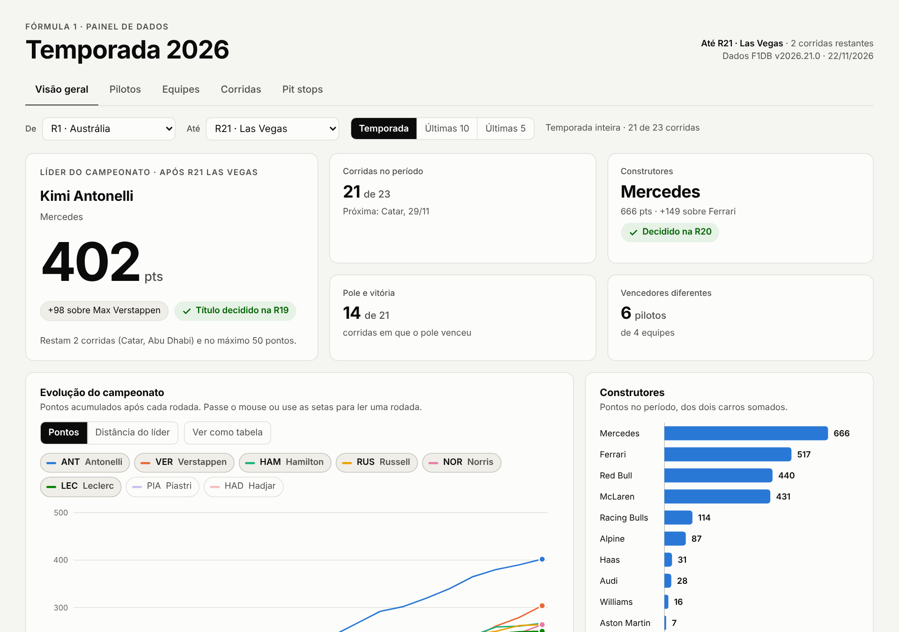
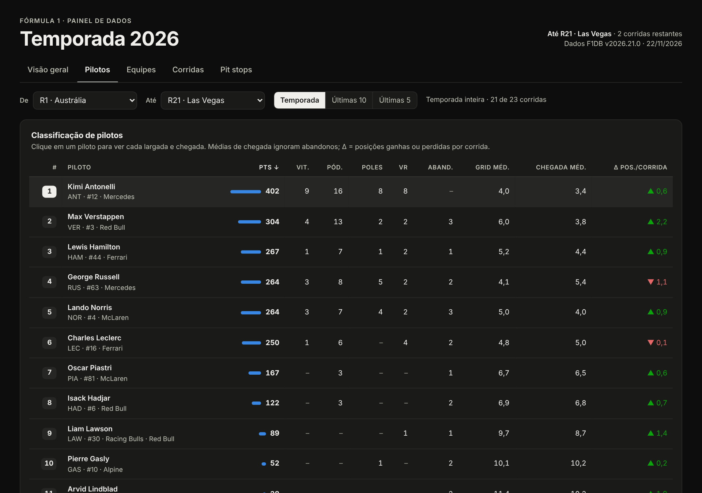

# F1 2026 — Pipeline de dados e painel interativo

Pipeline em Python (pandas) que transforma os dados abertos da temporada 2026 de Fórmula 1 em uma base analítica
limpa e validada (CSV e Excel) e em um **painel interativo** (HTML + JavaScript, sem dependências) com campeonato,
pilotos, equipes, corridas e pit stops.

**Painel online:** https://victorchantre08.github.io/dashboard-formula1/

| Visão geral (tema claro) | Pilotos (tema escuro) |
|---|---|
|  |  |

## Fonte dos dados

| Fonte | Uso | Licença |
|---|---|---|
| [F1DB](https://github.com/f1db/f1db) | Fonte primária: calendário, pilotos, equipes, resultados, qualificação, pit stops, classificações | CC BY 4.0 |

O pipeline registra em `data/processed/manifest.json` exatamente qual versão da fonte foi usada
(release, commit e data), para que qualquer número possa ser rastreado até a origem.

> Atribuição: *Dados: F1DB (github.com/f1db/f1db), licença CC BY 4.0.*

Referências oficiais para auditoria: [formula1.com/results](https://www.formula1.com/en/results) e as
[classificações da FIA](https://api.fia.com/events/fia-formula-one-world-championship/season-2026/2026-classifications).

## Como funciona

```
extract.py   ->  transform.py  ->  validate.py  ->  load.py        ->  export.py
git clone/        pandas: merges,    checagens de      CSVs + Excel      dashboard/data.json
pull do F1DB      explode, groupby   consistência      + manifest.json   (consumido pelo painel)
```

| Etapa | O que faz |
|---|---|
| **Extract** | Clona (ou atualiza) o F1DB em `data/raw/f1db` e registra a versão usada |
| **Transform** | Lê os YAML, empilha as corridas, cruza com os cadastros (pilotos, equipes, circuitos, países), converte tempos em segundos, separa posição numérica de situação (DNF, DNS, NC...) e calcula métricas por piloto e equipe |
| **Validate** | Confere que os pontos de corridas + sprints fecham com as classificações oficiais, que não há duplicatas, que todo ID tem nome, etc. O pipeline termina com erro se algo não fechar |
| **Load** | Grava um CSV por tabela, um Excel formatado (tabelas, filtros, aba de validação) e o manifesto da fonte |
| **Export** | Gera `dashboard/data.json`, um JSON compacto (uma linha por piloto por corrida) que o painel lê |

## Como executar

```bash
python -m venv .venv && source .venv/bin/activate   # Windows: .venv\Scripts\activate
pip install -r requirements.txt

python run_pipeline.py                # baixa/atualiza o F1DB e gera tudo
python run_pipeline.py --skip-extract # reaproveita o F1DB já baixado
python run_pipeline.py --year 2025    # outra temporada

pytest                                # testes
```

Requisitos: Python 3.10+ e `git` instalado (testado com Python 3.13 e pandas 3.0).

### Abrir o painel

O painel carrega `data.json` com `fetch`, então precisa ser aberto por um servidor (não por duplo clique no arquivo):

```bash
python -m http.server 8000 --directory dashboard
# abra http://localhost:8000
```

## O painel

Cinco visões: **Visão geral** (líder, evolução do campeonato, construtores), **Pilotos** (tabela com vitórias,
pódios, poles, abandonos, grid e chegada médios, saldo de posições; clique para ver cada corrida do piloto),
**Equipes** (inclui fabricantes de motor), **Corridas** (calendário, pole, volta mais rápida; clique para a
classificação completa) e **Pit stops** (distribuição e mediana por equipe).

- Filtro por intervalo de rodadas (temporada, últimas 10, últimas 5 ou De/Até): todas as classificações são
  recalculadas no navegador, com critério de desempate por contagem de posições.
- Aviso de **título decidido**: compara a vantagem do líder com o máximo de pontos ainda em disputa
  (25 por corrida + 8 por sprint para pilotos; 43 + 15 para equipes).
- Tema claro e escuro (segue o sistema), tooltips, navegação por teclado, visão em tabela dos gráficos e layout
  para celular. Cores categóricas fixas por piloto, validadas para daltonismo.

### Painel online

O painel é publicado pelo GitHub Pages, a partir da branch `main`. Para ativar (uma vez só): em
**Settings → Pages**, escolha *Deploy from a branch*, branch `main` e pasta `/ (root)`. O GitHub gera o endereço
`https://<usuario>.github.io/<repositorio>/`; o `index.html` da raiz leva direto para `dashboard/`. Qualquer
pessoa com o link pode abrir e usar os filtros, sem instalar nada. A cada push na `main` o
site é republicado.

## Saídas

- `data/processed/*.csv`: uma tabela por arquivo (UTF-8, datas em `YYYY-MM-DD`)
- `output/F1_2026_base_de_dados.xlsx`: as mesmas tabelas, mais as abas `LEIA-ME` e `Validacao`
- `data/processed/manifest.json`: versão da fonte e contagem de linhas por tabela
- `dashboard/data.json`: dados do painel

### Modelo de dados

| Tipo | Tabelas |
|---|---|
| Dimensões | `Calendario`, `Pilotos`, `Equipes`, `Equipe_Pilotos` |
| Fatos | `Resultados_Corrida`, `Resultados_Sprint`, `Qualificacao`, `Grid_Largada`, `Pit_Stops`, `Voltas_Rapidas`, `Piloto_do_Dia` |
| Classificações | `Classif_Pilotos`, `Classif_Construtores`, `Classif_Pilotos_Rodada`, `Classif_Construtores_Rodada` |

As tabelas se relacionam por `Rodada`, `Piloto_ID` e `Equipe_ID` (esquema estrela: fatos ligados às dimensões
por esses IDs). Notas de modelagem:

- `Posicao` vazia significa não classificado; o motivo está em `Situacao` (`DNF`, `DNS`, `NC`...).
- Horários em UTC. Nomes de pilotos, equipes e países ficam em inglês, como na fonte.
- `Pilotos` e `Equipes` trazem `Pontos_Oficiais` (da classificação), `Pontos_Calculados` (corridas + sprints)
  e `Diferenca`, para auditar a consistência da própria base.
- Pilotos reservas aparecem em `Pilotos` com `Papel = Piloto de testes/reserva` e, quando atendem a duas
  equipes, ambas ficam listadas.

### Particularidades da temporada 2026

- **R16 "Bahrain Grand Prix" foi disputado em Sepang (Malásia).** Não é erro da base: Bahrein e Arábia Saudita
  saíram do calendário e a prova foi realizada na Malásia sob o nome oficial *Gulf Air Bahrain Grand Prix in
  Malaysia*. O painel mostra "Bahrein (Sepang)".
- **R13 (Itália) teve bandeira vermelha na volta 3** (acidente de Leclerc). A fonte registra 21 paradas de cerca de
  31 minutos, que são a espera no box. O painel as exclui do cálculo de pit stops (limite de 600 s) e informa
  a exclusão; a tabela `Pit_Stops` mantém os registros originais.

## Validação e qualidade

O pipeline roda 10 verificações a cada execução (aba `Validacao` e saída no terminal). Na execução de referência
(F1DB v2026.21.0, rodadas 1 a 21), todas passaram: 2.337 pontos fecham entre pilotos e construtores, sem diferença
em nenhum piloto ou equipe, e há 21 vitórias para 21 corridas.

Conferências externas feitas durante o desenvolvimento:

| Conferência | Resultado |
|---|---|
| Classificação após a R17 contra a [Wikipedia](https://en.wikipedia.org/wiki/2026_Formula_One_World_Championship) (23 pilotos e 11 equipes) | Nenhuma diferença |
| Vencedores das rodadas 1 a 18 contra a Wikipedia | Nenhuma diferença |
| Classificação final após a R21 (25 pilotos e 11 equipes) contra a [PlanetF1](https://www.planetf1.com/news/f1-championship-standings-2026-las-vegas-grand-prix) | Nenhuma diferença |
| Calendário (23 rodadas, GPs, cidades e fins de semana de prova) contra a [Crash.net](https://www.crash.net/f1/news/1073119/1/2026-f1-calendar-full-race-schedule-revealed) | Confere, incluindo Sepang. Datas em UTC: Las Vegas aparece em 22/11 (largada às 04:00 UTC, sábado à noite no local) |
| Tabelas do pipeline contra uma implementação independente anterior (script manual com openpyxl) | 49.881 células comparadas, nenhuma divergência |

Testes automatizados (`pytest`, 13 testes): leitura de YAML, transformação e validação de uma mini-temporada
sintética ponta a ponta (inclui o caso de a validação falhar quando os pontos não fecham) e exportação para o
painel (formato das linhas, exclusão de paradas de bandeira vermelha, rejeição de sprint sem corrida).

## Decisões técnicas

- **pandas, e não PySpark.** A base inteira tem alguns milhares de linhas; mesmo a história completa da F1 cabe
  em memória. Spark adicionaria complexidade e custo de inicialização sem ganho. O pipeline é organizado em
  extract/transform/validate/load justamente para que a troca de ferramenta seja localizada se o volume crescer.
- **Leitura de YAML sem a regra sexagesimal do YAML 1.1.** O PyYAML padrão transforma `14:00` em `840`; o
  loader em `yamlio.py` evita isso (há teste cobrindo o caso).
- **Rastreabilidade.** Dado bruto fica separado do processado, e o commit da fonte é registrado a cada execução.
- **Validação como parte do pipeline**, e não como passo manual: se os pontos não fecham, a execução falha.
- **Painel sem framework e sem build.** HTML, CSS e JavaScript puros com SVG inline: abre em qualquer servidor
  estático e não depende de CDN. Os cálculos por intervalo de rodadas ficam no navegador, então o JSON leva só
  fatos, sem agregados pré-calculados.

## Atualização automática

`.github/workflows/update-data.yml` roda às segundas e terças (09:00 UTC), executa os testes e o pipeline e
grava no repositório os arquivos que mudaram. Também pode ser disparado manualmente na aba *Actions*. Faltam
duas corridas na temporada: Catar (29/11) e Abu Dhabi (06/12).

## Estrutura do repositório

```
dashboard-formula1/
├── run_pipeline.py          # ponto de entrada (CLI)
├── requirements.txt
├── src/f1pipeline/
│   ├── config.py            # caminhos e constantes
│   ├── yamlio.py            # leitura de YAML
│   ├── extract.py           # sincroniza o F1DB
│   ├── transform.py         # YAML -> tabelas (pandas)
│   ├── validate.py          # checagens de qualidade
│   ├── load.py              # CSV + Excel + manifesto
│   └── export.py            # tabelas -> dashboard/data.json
├── index.html               # redireciona para dashboard/ (GitHub Pages)
├── dashboard/               # index.html + data.json (painel)
├── tests/                   # pytest (helpers, mini-temporada, exportação)
├── docs/                    # imagens do README
├── .github/workflows/       # atualização automática dos dados
├── data/
│   ├── raw/                 # clone do F1DB (ignorado pelo git)
│   └── processed/           # CSVs gerados
└── output/                  # Excel gerado
```

## Próximos passos

- Versão do dashboard no Power BI sobre as tabelas de `data/processed/`.
- Complementar com outras fontes (por exemplo, telemetria) caso o escopo cresça.
